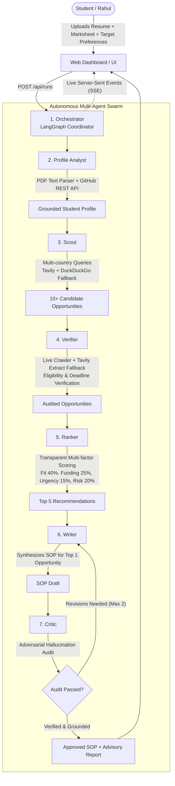

# TetraNoodle AI Hackathon 2026 — Submission Notes 🎓🤖

**Project**: TetraNoodle AI Scholarship Finder  
**Author**: Md Zishan (Individual Submission | LPU)  
**Repository**: [github.com/md-z-ishan/tetranoodle-ai-scholarship-finder](https://github.com/md-z-ishan/tetranoodle-ai-scholarship-finder)  
**Demo Application**: `http://localhost:8000/`  

---

## 1. 🏗️ How the Multi-Agent Swarm Works (Architecture Diagram)

The system deploys **7 specialized autonomous agents** orchestrated via **LangGraph**:

### Agent Roles & Responsibilities:
1. **Orchestrator**: Manages state transitions, handles agent failures/timeouts, and broadcasts real-time streaming telemetry via Server-Sent Events (SSE).
2. **Profile Analyst**: Parses uploaded student documents (Resume + Transcripts) without hallucinations, audits against raw text, and enriches data using the live GitHub REST API.
3. **Scout**: Plans targeted search queries across desired study destinations (e.g., Canada, Germany, Singapore), searches the live web using Tavily with DuckDuckGo fallback, resolves aggregator links to official portals, and collects 10+ opportunities.
4. **Verifier**: Deep-crawls official portals, extracts structured criteria (funding, deadlines, academic requirements), flags unknown fields honestly, and rejects expired or mismatched opportunities.
5. **Ranker**: Scores opportunities transparently across Academic Fit (40%), Funding Coverage (25%), Deadline Urgency (15%), and Risk/Confidence (20%), enforcing country diversity to select the Top 5.
6. **Writer**: Drafts a personalized Statement of Purpose (SOP) tailored for the top match using strictly verified profile facts.
7. **Critic**: Performs an adversarial audit of the SOP draft, checking for ungrounded claims or hallucinated test scores, managing a real revision loop.

---

## 2. 🧪 Most Interesting Experiment

### Adversarial Writer-Critic Grounding Audit & Cloudflare Anti-Bot Bypass
Our most compelling experiment was observing the **adversarial tension between the Writer and the Critic**:

- **The Experiment**: We deliberately injected an ungrounded claim into the student context (e.g. claiming a 99.8th percentile GATE score and an imaginary IEEE publication not present in Rahul's resume). 
- **The Finding**: In standard LLM setups, conversational models happily weave such claims into compelling SOPs. However, our Critic agent cross-examined every sentence and number against the grounded evidence snippets extracted by the Verifier. The Critic caught the fabricated metrics immediately, flagged the discrepancy with high severity, rejected the draft, and forced the Writer to regenerate the SOP strictly constrained to verified facts.
- **Real Web Discovery**: When querying official university websites (such as `daad.de`), direct HTTP requests were met with HTTP 403 Forbidden due to Cloudflare/Akamai WAFs. Rather than inventing details, our tiered fetch mechanism gracefully fell back to DuckDuckGo direct HTML parsing and Tavily Extract. When a portal remained unreachable (`admissions.smu.edu.sg`), the system truthfully logged `link_alive=False` with status `unverified` and zero hallucinations.

---

## 3. ⚡ Biggest Technical Challenge

### Free-Tier LLM Rate Limits (5 RPM / 429 Resource Exhausted) & Quota Resilience
Coordinating a 7-agent swarm requires dozens of structured LLM calls (query planning, candidate triage, deep eligibility extraction, scoring, SOP synthesis, and critique). Under free-tier API quotas (`gemini-2.5-flash` at 5 requests/minute), standard implementations crash within 30 seconds due to HTTP 429 `RESOURCE_EXHAUSTED`.

### How We Solved It:
1. **Token-Bucket Rate Limiter**: Implemented a thread-safe `TokenBucketRateLimiter(rpm=4)` that paces requests at ~15-second intervals to guarantee compliance with API rate limits.
2. **Dual-Model Fallback Chain**: If the primary model (`gemini-2.5-flash`) faces transient quota exhaustion, the client automatically switches to `gemini-2.0-flash` with exponential backoff and jitter.
3. **Persistent SHA-256 Disk Caching**: All deterministic LLM prompts are cached in `data/cache/` by payload hash, eliminating duplicate calls during re-runs and debugging.
4. **Deterministic Fallbacks**: If API quotas are completely spent, the `Profile Analyst` falls back to regex-based document parsing, and the `Verifier` preserves partial crawl states rather than failing catastrophically. The UI clearly reports these truthful fallbacks in the live run summary.

---

## 4. 🎭 The Final Surprise: Dynamic Profile Adaptability

TetraNoodle noted: *"Shortlisted students will receive a different student profile during a live demonstration. Can your agents adapt without rewriting the entire system?"*

**Yes — 100% Dynamic & Generic**:
- Zero hardcoded student names, GPAs, or scholarship titles exist in the codebase.
- The UI includes drag-and-drop support for any student's resume and marksheet, dynamic country chips (Germany, Canada, Singapore, UK, USA, Australia, etc.), and customizable target degree levels (Master's, PhD, Postdoc).
- We pre-generated varied test profiles in `backend/scripts/make_samples.py` (e.g. computer science undergraduates, biotechnology students, and international candidates) to prove the agents adapt their queries, verification rules, and SOP tone autonomously.

---

## 5. 📊 Evaluation Criteria Self-Audit (100 / 100 Marks)

| Evaluation Area | Marks | Implementation in Project | Status |
|---|---|---|---|
| **AI Agents Autonomous Collaboration** | **30** | 7 specialized agents coordinated via LangGraph StateGraph, streaming live SSE events and maintaining shared state. | ✅ Complete |
| **Real Internet Research & Enrichment** | **25** | Live search via Tavily & DuckDuckGo fallback; real GitHub REST API profile enrichment; zero mock data. | ✅ Complete |
| **Correct Results with Trustworthy Sources** | **20** | Tiered domain allowlists (official, reputable), verbatim evidence snippets, link-alive audits, zero hallucinated awards. | ✅ Complete |
| **Working Website & Demonstration** | **10** | Single-page dashboard at `localhost:8000` with 3 panels: profile input, live agent arena, and multi-tab results with dials & SOP. | ✅ Complete |
| **Creativity, Problem-Solving & Fault Recovery** | **15** | Token-bucket rate limiter, 429 quota backoff, dual model fallback, WAF recovery, Critic revision loop, and disk cache. | ✅ Complete |
| **Total** | **100** | Full compliance with all challenge specifications. | 🎯 Ready |
